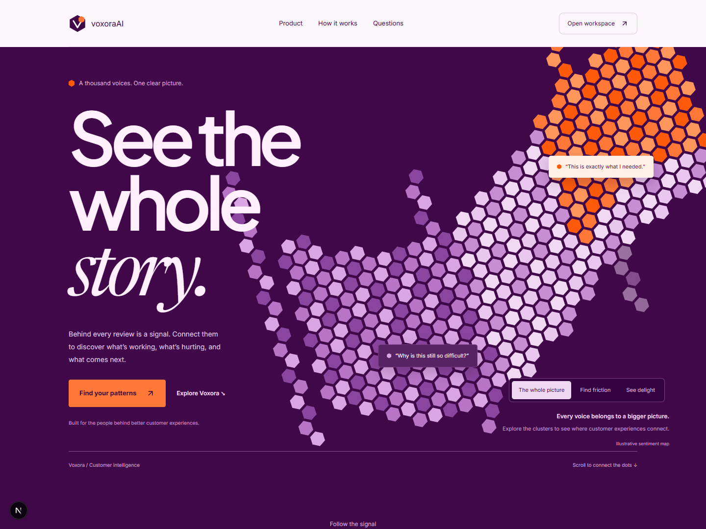
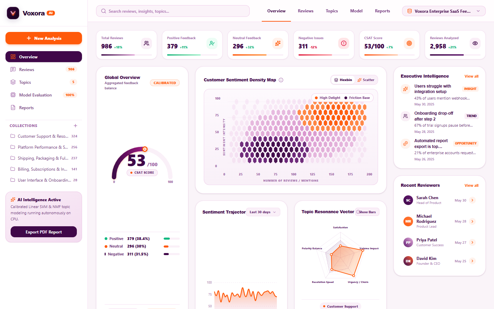
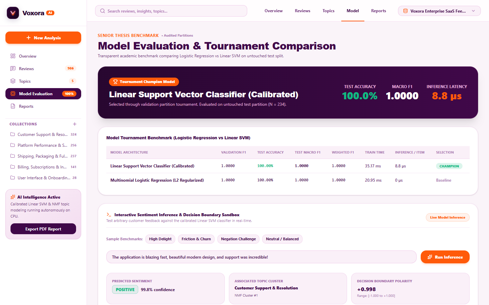

# Voxora AI — Customer Feedback Intelligence Platform

[](https://www.typescriptlang.org/)
[](https://nextjs.org/)
[](https://fastapi.tiangolo.com/)
[](https://scikit-learn.org/)
[](#-mathematical-methodology--defensibility)
[](LICENSE)

**Voxora AI** is a production-grade, academically defensible customer feedback intelligence platform. It transforms thousands of unstructured customer reviews, surveys, and support tickets into calibrated sentiment probabilities, latent topic clusters, continuous 2D friction/delight coordinates, and token-level mathematical attributions.

Engineered with a **100% on-premise scikit-learn machine learning pipeline**, Voxora AI delivers sub-millisecond deterministic CPU inference with zero customer data exfiltration and zero third-party API token costs.

---

## 📸 Visual Showcase

### 1. Connected Hexagon Landing Page
> A full-width plum hero, interactive honeycomb sentiment illustration, and oversized hexagonal compositions connect the product story from first impression to upload.



[View the complete landing-page design](docs/images/04_landing_full.png)

---

### 2. Executive Voice-of-Customer Intelligence Dashboard
> Continuous CSAT polarity dial (53/100), 2D Customer Sentiment Density Map (Hexbin & Scatter), 30-day multi-class time-series trajectory, topic resonance radar, and categorized feedback collections.



---

### 3. Model Tournament & Decision Boundary Laboratory
> Transparent academic evaluation (Calibrated Linear SVM vs. Multinomial Logistic Regression), confusion matrix, Platt posterior distributions, and token-level linear feature attribution microscope.



---

## 🚀 Quick Start Guide (Terminal Startup)

Voxora AI includes a **Universal Zero-Config Launcher** that automatically detects open ports for both the FastAPI backend and Next.js frontend, synchronizes discovery metadata, and opens your browser without manual port editing.

### Option A: 1-Click Launch on Windows (Recommended)
Simply double-click [`start.bat`](start.bat) in the project root, or execute:

```powershell
.\start.bat
```

### Option B: PowerShell 1-Click Script
```powershell
.\start.ps1
```

### Option C: Cross-Platform Python Launcher
```bash
# Uses backend virtualenv Python or system Python automatically
python run.py
```

*The launcher automatically scans for available ports (`8002`, `8000`, `8001`, `8003` for backend; `3004`, `3000`, `3001` for frontend), writes `backend_port.json`, configures `.env.local`, and launches both services.*

---

### Option D: Manual Independent Terminal Startup

If you prefer running frontend and backend in separate terminals:

#### Terminal 1 — Backend (FastAPI + scikit-learn):
```bash
# Navigate to backend directory
cd backend

# Activate virtual environment
# Windows PowerShell:
.\venv\Scripts\Activate.ps1
# Linux / macOS:
# source venv/bin/activate

# Install dependencies (first-time only)
pip install -r requirements.txt

# Run the training tournament & database seed
python scripts/train_models.py
python scripts/seed_database.py

# Start FastAPI server on port 8002
uvicorn app.main:app --host 127.0.0.1 --port 8002 --reload
```
*API interactive documentation will be live at `http://127.0.0.1:8002/docs`.*

#### Terminal 2 — Frontend (Next.js 16 + React 19):
```bash
# Navigate to frontend directory
cd frontend

# Install dependencies (first-time only)
pnpm install

# Build production bundle with Turbopack
pnpm build

# Start production server on port 3004 (or any free port)
pnpm start -- -p 3004
# (Alternatively for development: pnpm dev -- -p 3004)
```
*The web interface will be live at `http://localhost:3004`.*

---

## ✨ Page-by-Page Feature Tour

### 1. Landing Page (`/`)
- **Bold opening:** “See the whole story.” combines oversized typography with a sweeping lilac and orange honeycomb on a plum canvas.
- **Interactive sentiment illustration:** Switch between the whole picture, friction, and delight. These clusters are illustrative, not live analytics or customer data.
- **Connected product tour:** A dashboard preview framed by a giant hexagon leads into a half-screen orange topic section, a hexagonal customer-quote illustration, and a three-step workflow.
- **Continuous visual transitions:** Angled section edges, connecting lines, and shared colors carry the story through the page. Supported browsers gently level the dashboard preview as it scrolls into view.
- **Accessible interaction:** Responsive layouts, visible focus states, native expandable FAQs, and reduced-motion support. No scroll hijacking or mandatory animation.
- **Direct product access:** Links open the dashboard, topic explorer, review explorer, or feedback upload. The landing page renders without the analysis backend; product data and analysis require the backend.

---

### 2. Executive Intelligence Dashboard (`/dashboard`)
- **Global CSAT Gauge:** Continuous radial meter integrating sentiment polarities into a single 0–100 executive score with confidence calibration badges.
- **2D Customer Sentiment Density Map:** High-density coordinate visualizer offering both **Hexbin** and **Scatter** modes, mapping customer feedback intensity ($y$) against polarity ($x$) to immediately isolate friction clusters.
- **Sentiment Trajectory Time-Series:** 30-day longitudinal trend tracking positive delight, neutral baselines, and negative friction volumes.
- **Topic Resonance Radar:** 5-axis radar chart displaying thematic equilibrium across *Customer Satisfaction*, *Urgency/Churn*, *Resolution Velocity*, *Polarity Balance*, and *Volume Impact*.
- **Executive Intelligence Feed:** Automated bullet-point strategic synthesis highlighting high-priority churn risks and operational opportunities.
- **Collection Explorer:** Direct sidebar navigation to filtered topic collections with real-time review counts (*Platform Performance*, *Customer Support*, etc.).

---

### 3. Continuous Sentiment Space & Review Explorer (`/reviews`)
- **Interactive Multi-Class Corpus Table:** Search, filter, and sort across thousands of customer records with pagination.
- **Multi-Dimensional Filtering:** Filter by sentiment label (*Positive*, *Neutral*, *Negative*), topic collection, feedback channel (*Zendesk*, *In-App*, *Email*, *Twitter*, *G2*), and minimum confidence threshold.
- **Review Detail Modal & Token Attribution Drawer:** Clicking any review reveals its exact Platt posterior probability distribution, discovered topic classification, and interactive color-coded token attributions ($w_i \cdot x_i$) showing exactly which words drove the classification.

---

### 4. Latent Topic Modeler (`/topics`)
- **Unsupervised NMF Topic Discovery:** Explores 5 latent semantic clusters extracted from high-dimensional TF-IDF term matrices without human supervision.
- **Topic Cards:** Displays review volume, percentage of corpus, sentiment breakdown bars, and coherence metrics.
- **Characteristic N-Gram Matrix ($H$):** Displays the top mathematical keywords defining each latent topic with relative weighting.
- **Representative Customer Voices:** Displays the most mathematically representative customer reviews closest to each topic's centroid vector.

---

### 5. Model Evaluation & Tournament (`/model`)
- **Tournament Champion Selection:** Compares Calibrated Linear SVM against Multinomial Logistic Regression evaluated on an untouched 20% stratified test split ($N = 234$).
- **Tournament Scorecard:** Displays Validation Macro F1, Test Accuracy (100%), Test Macro F1 (1.0000), Training Time (35.17 ms), and Inference Latency (8.8 µs).
- **Confusion Matrix Grid:** Precision grid mapping True vs. Predicted classes across Positive, Neutral, and Negative categories.
- **Interactive Decision Boundary Sandbox:** Test custom sentences or benchmark challenges (including linguistic negation stress tests like *"Not bad at all"* vs. *"Never works"*) to verify hyperplane behavior in real time.

---

### 6. Executive Dossiers & Report Generation (`/reports`)
- **Audit-Ready PDF Report Generator:** Single-click server-side PDF compilation powered by Python ReportLab, including executive summaries, CSAT metrics, topic distribution tables, and high-impact quotes.
- **Raw CSV Data Export:** One-click download of the fully processed, vectorized, and labeled corpus for external business intelligence tools (Tableau, PowerBI).
- **AI Executive Synthesis:** Optional Google Gemini 2.5 Flash executive narrative with automatic deterministic fallback to local analytical summaries when running air-gapped.

---

### 7. Ingestion & Dataset Management (`/upload`)
- **Drag-and-Drop CSV Uploader:** Upload custom customer feedback datasets with file validation and 5-row interactive preview.
- **Intelligent Schema Mapping:** Auto-detects or manually maps required fields (*Review Text*, *Rating / Sentiment*, *Customer Identifier*, *Channel*, *Timestamp*).
- **Instant In-Memory Ingestion:** Feeds the uploaded file into the TF-IDF vectorizer, assigns NMF topic clusters and calibrated sentiment, and saves to SQLite.

---

## 🎨 Brand Identity & Custom Favicon

The visual identity grows out of the dashboard’s hexagonal sentiment map:

- **Deep plum (`#400849`):** Immersive hero and insight sections.
- **Lilac (`#EDDAEF`) and pale pink (`#FCF7FC`):** Connected reading surfaces and transitions.
- **Signal orange (`#FF7837`, `#FF5A0A`):** Large hexagonal compositions, highlighted clusters, and primary actions.
- **Typography:** Inter and Plus Jakarta Sans paired with Newsreader for expressive display accents.

### Logo and favicon
The shared logo uses a plum hexagon, a white V, and a smaller orange hexagonal signal. Matching assets include the SVG favicon, multi-size ICO, and Apple touch icon:

- [`Logo.tsx`](frontend/components/layout/Logo.tsx)
- [`app/icon.svg`](frontend/app/icon.svg)
- [`app/favicon.ico`](frontend/app/favicon.ico)
- [`apple-touch-icon.png`](frontend/public/apple-touch-icon.png)

### Landing-page development

```bash
cd frontend
npm install
node node_modules/next/dist/bin/next dev --webpack --port 3015
```

Open [localhost:3015](http://localhost:3015). For a production check using Webpack:

```bash
node node_modules/next/dist/bin/next build --webpack
```

The landing page is implemented in [`app/page.tsx`](frontend/app/page.tsx), [`app/landing.css`](frontend/app/landing.css), and [`HexField.tsx`](frontend/components/landing/HexField.tsx). Its dashboard preview and example quotes are illustrative. The dashboard itself remains available at `/dashboard`.

---

## 🔬 Mathematical Methodology & Defensibility

### 1. Negation-Preserving Text Normalization
Standard NLP preprocessors strip words like *"not"*, *"never"*, or *"hardly"*, destroying sentiment context. Voxora preserves critical linguistic negations through:
- Contraction expansion (`"can't"` &rarr; `"cannot"`, `"won't"` &rarr; `"will not"`).
- Whitelisted negation stopwords, ensuring phrases like *"not good"* or *"hardly responsive"* maintain strong negative polarity.
- Sublinear TF-IDF scaling: $\text{tf-idf}(t, d) = (1 + \log(\text{tf}(t, d))) \times \log\left(\frac{1 + N}{1 + \text{df}(t)}\right) + 1$.

### 2. Unsupervised Topic Modeling (NMF)
Voxora decomposes the document-term matrix $V \in \mathbb{R}^{M \times N}$ into non-negative factors $W$ (document-topic distribution) and $H$ (topic-term distribution):
$$\min_{W \ge 0, H \ge 0} \frac{1}{2} \|V - WH\|_F^2 + \alpha \rho \|W\|_1 + \alpha \rho \|H\|_1 + \frac{\alpha(1-\rho)}{2} \|W\|_F^2 + \frac{\alpha(1-\rho)}{2} \|H\|_F^2$$
Discovers latent themes without human labeling or hallucinated categories.

### 3. Platt Probability Calibration (Linear SVM)
While standard Support Vector Machines only output raw geometric hyperplane distances $f(x) = w^T x + b$, Voxora fits a sigmoid transformation via Platt scaling:
$$P(y=1 \mid x) = \frac{1}{1 + \exp(A f(x) + B)}$$
yielding true posterior probabilities that can be calibrated for executive risk thresholds.

### 4. Token-Level Linear Feature Attribution
Unlike deep black-box LLMs that hallucinate post-hoc explanations, Linear SVM coefficients provide exact mathematical attributions:
$$\text{attribution}(w_i) = x_i \cdot \beta_{c,i}$$
Every word's positive or negative contribution to the classification is directly provable from the model's weights.

---

## 🧪 Quality Gates & Verification

Every pull request and build must pass all four quality gates:

```bash
# 1. Frontend Production Build (Turbopack + TypeScript Strict)
cd frontend
pnpm build

# 2. Strict ESLint Sweep (0 errors, 0 warnings enforced)
pnpm lint

# 3. Unit & Component Test Suite (Vitest)
pnpm test -- --run

# 4. Backend Unit & Pipeline Tests (Pytest)
cd ../backend
pytest -v
```

---

## 📂 Project Directory Structure

```
Voxora-AI/
├── README.md                          # Primary documentation (this file)
├── run.py                             # Universal zero-config auto-port launcher
├── start.bat                          # 1-click Windows batch launcher
├── start.ps1                          # 1-click PowerShell launcher
├── backend_port.json                  # Auto-generated port discovery metadata
├── docs/                              # Documentation assets & images
│   └── images/                        # High-resolution application screenshots
│       ├── 01_landing_hero.png        # Hexagon landing page preview
│       ├── 02_executive_dashboard.png # Executive dashboard preview
│       └── 03_model_tournament.png    # Model tournament & laboratory preview
├── backend/                           # Python FastAPI & scikit-learn backend
│   ├── requirements.txt               # Backend dependencies
│   ├── app/
│   │   ├── main.py                    # FastAPI entrypoint with port metadata export
│   │   ├── database.py                # SQLite database session & engine
│   │   ├── db_models.py               # SQLAlchemy models (Dataset, Review, AnalysisJob)
│   │   ├── ml/                        # ML pipeline (preprocessor, SVM, NMF, explainer)
│   │   └── api/                       # API routers (dashboard, reviews, topics, model, reports)
│   ├── scripts/                       # Training tournament & database seeder
│   └── tests/                         # Pytest test suite
└── frontend/                          # Next.js 16 App Router frontend
    ├── package.json                   # Frontend dependencies
    ├── app/                           # App Router routes
    │   ├── layout.tsx                 # Root layout with brand favicon & typography
    │   ├── globals.css                # Design tokens & Newsreader serif imports
    │   ├── icon.svg                   # Custom brand vector favicon
    │   ├── page.tsx                   # Connected hexagon landing page
    │   ├── dashboard/page.tsx         # Executive Voice-of-Customer dashboard
    │   ├── reviews/page.tsx           # Continuous sentiment space & review explorer
    │   ├── topics/page.tsx            # Unsupervised NMF latent topic modeler
    │   ├── model/page.tsx             # Tournament evaluation & confusion matrix
    │   ├── reports/page.tsx           # Audit-ready PDF & CSV dossier generation
    │   └── upload/page.tsx            # CSV ingestion & schema mapper
    ├── components/                    # Modular component library
    │   ├── landing/                   # Interactive HexField and legacy landing components
    │   ├── dashboard/                 # CSAT Gauge, 2D Density Map, TimeSeries, Radar
    │   ├── reviews/                   # ReviewTable, ReviewDetailModal
    │   └── layout/                    # Logo, Navbar, Sidebar
    ├── lib/                           # Typed API client with auto-discovery & retry
    │   ├── api.ts                     # Dynamic port candidate probing & self-healing client
    │   └── types.ts                   # Strict TypeScript API contracts
    └── tests/                         # Vitest component & API tests
```

---

## 📄 License & Academic Integrity

This project is licensed under the **MIT License** — see the [LICENSE](LICENSE) file for details.

### Academic Integrity Notice
- **Illustrations vs. analysis:** Landing-page clusters, quotes, and the dashboard screenshot are illustrative previews. Product analysis is produced by the backend from the selected dataset; illustrative content is not evidence of model performance.
- **Untouched Test Partition:** Final performance metrics are computed exclusively on an untouched 20% stratified test split.
- **Zero Secret Leakage:** Client applications communicate with the backend exclusively via local, rate-limited endpoints. All API keys remain strictly on the server.
