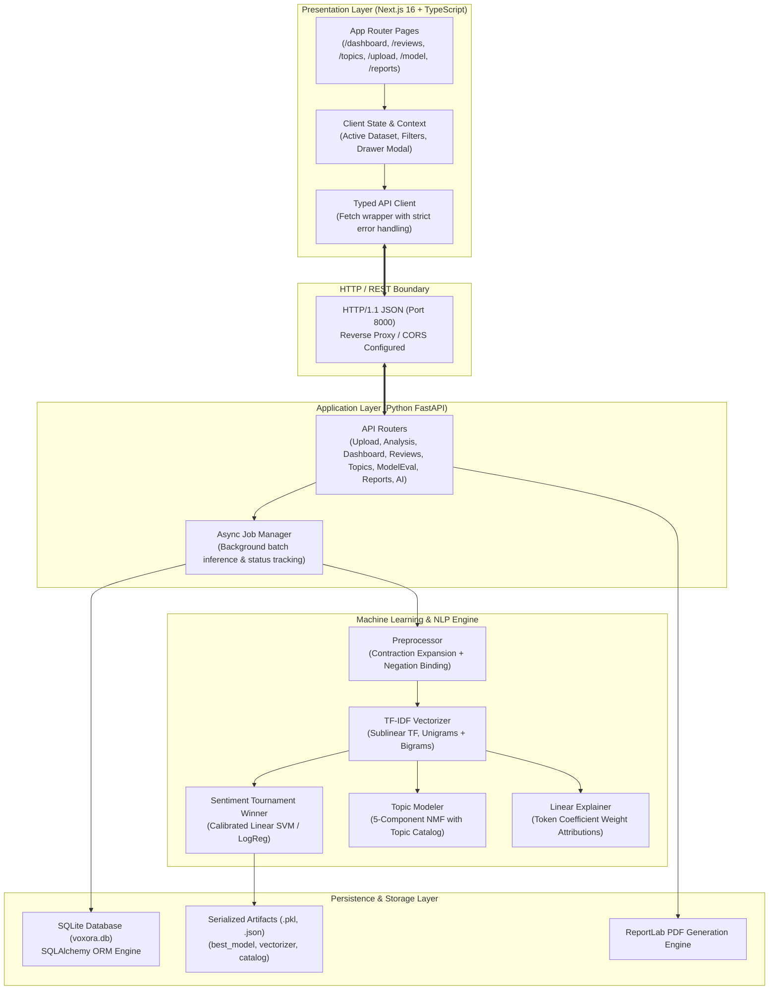
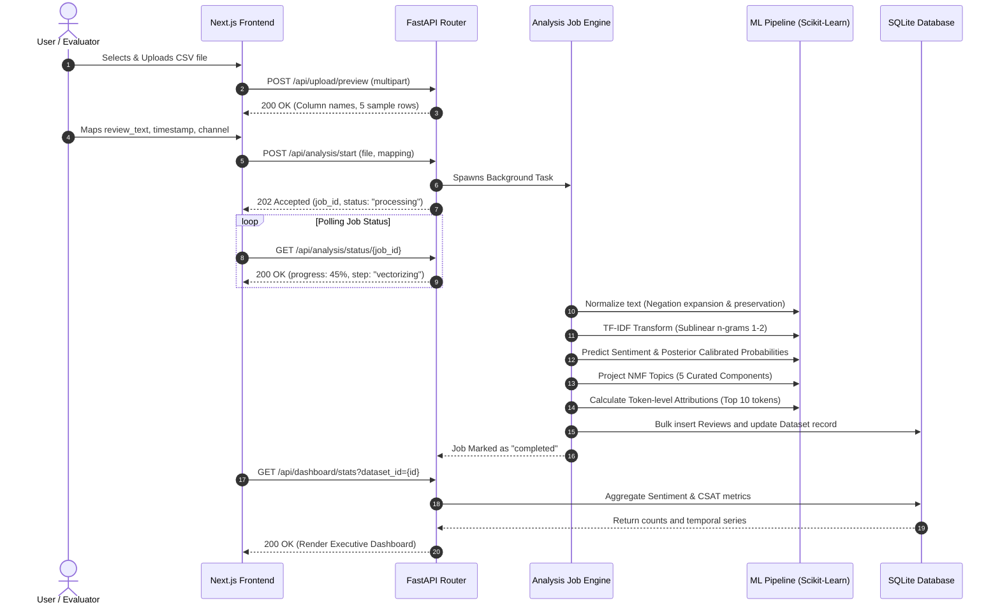

# Voxora AI — Software Architecture Specification

## 1. Executive Summary

Voxora AI is an enterprise customer feedback intelligence platform designed to ingest raw, unstructured customer review datasets, execute rigorous natural language processing and machine learning workflows, and deliver actionable insights through a human-centered executive dashboard.

The architecture emphasizes:
- **Clean Separation of Concerns**: Decoupled presentation (Next.js 16 App Router) and computation (Python FastAPI + scikit-learn).
- **Academic Reproducibility**: Deterministic data preprocessing, isolated train/validation/test partitions, and transparent mathematical attributions.
- **Production Reliability**: 100% type-safe contracts across the network boundary, zero client-side secret exposure, sublinear asymptotic search performance, and local SQLite persistence.

---

## 2. System Architecture Diagram



---

## 3. Frontend Architecture

### 3.1 Technology Stack & Directory Layout
- **Framework**: Next.js 16 (App Router)
- **Language**: TypeScript with strict mode enabled (`strict`, `noImplicitAny`, `noUncheckedIndexedAccess`)
- **Styling**: Tailwind CSS v4 utilizing tokenized custom CSS variables
- **Iconography**: Lucide React
- **Data Visualization**: Recharts (ResponsiveContainer, AreaChart, BarChart, Tooltip)
- **Motion**: Framer Motion (page transitions, gauge animators, drawer sheets)

```
frontend/
├── app/
│   ├── layout.tsx              # Root HTML wrapper, Plus Jakarta Sans & Inter font loaders
│   ├── globals.css             # Tailwind imports, brand palette custom variables
│   ├── page.tsx                # Landing page with hero, live previewer & workflow
│   ├── dashboard/page.tsx      # Voice of Customers executive overview
│   ├── upload/page.tsx         # Drag-and-drop CSV uploader & schema mapper
│   ├── reviews/page.tsx        # Multi-filter review explorer & detail drawer
│   ├── topics/page.tsx         # Topic intelligence breakdown & keyword clouds
│   ├── model/page.tsx          # Tournament evaluation metrics & confusion matrix
│   └── reports/page.tsx        # PDF preview, CSV exporter & AI synthesis
├── components/
│   ├── layout/
│   │   ├── Sidebar.tsx         # Global navigation with active route highlights
│   │   └── Navbar.tsx          # Dataset switcher, status badge, demo seeder button
│   ├── dashboard/
│   │   ├── SentimentGauge.tsx  # Radial SVG CSAT gauge with class breakdown bars
│   │   ├── TimeSeriesChart.tsx # Multi-sentiment volume and trajectory chart
│   │   ├── SentimentMap.tsx    # 2D customer sentiment scatter visualization
│   │   ├── HighlightsCard.tsx  # Prioritized executive findings and complaint cards
│   │   └── ChannelDistribution.tsx # Channel-level satisfaction pill cards
│   ├── reviews/
│   │   ├── ReviewTable.tsx     # Virtualized searchable review table
│   │   └── ReviewDetailModal.tsx # Review drawer with token attributions
│   ├── topics/
│   │   └── TopicCard.tsx       # NMF topic cluster cards with keyword pills
│   └── model/
│       └── ConfusionMatrixGrid.tsx # 3x3 interactive heatmap table
└── lib/
    ├── tokens.ts               # 8pt grid, colors, font scales, radii
    ├── types.ts                # Strict TypeScript interfaces matching backend models
    ├── api.ts                  # Typed client with unified fetch handling
    └── utils.ts                # Formatting, tailwind-merge, date parsing
```

### 3.2 Design Token System
Adhering to user design governance, all layout rules conform to an **8pt grid** system:
- **Primary Violet**: `#6D4AFF` (Brand identity, interactive states, key charts)
- **Soft Lavender**: `#B6A4FF` (Secondary accents, borders, sub-elements)
- **Background**: `#F5F2FF` (Warm, non-generic application canvas)
- **Ink**: `#161327` (High-contrast, accessible typography)
- **Accent Amber**: `#FFB86B` (Neutral sentiment marker, highlights)
- **Success Emerald**: `#10B981` (Positive sentiment marker)
- **Danger Rose**: `#F43F5E` (Negative sentiment marker)

---

## 4. Backend Architecture

### 4.1 Layered Service Design
The backend is structured into clear computational domains:

1. **Presentation / Routing Layer (`app/routers/`)**:
   Validates incoming JSON payloads and HTTP multipart form uploads using Pydantic schemas. Translates exceptions to standardized HTTP error responses.
2. **Business / Job Layer (`app/routers/analysis.py`)**:
   Coordinates asynchronous analysis pipelines. Generates persistent job IDs and manages thread execution for batch vectorization and inference without blocking the FastAPI event loop.
3. **Machine Learning Layer (`app/ml/`)**:
   Contains pure, self-contained algorithms for text cleaning, vector transformation, model inference, topic projection, and linear coefficient attribution.
4. **Persistence Layer (`app/database.py`, `app/db_models.py`)**:
   SQLAlchemy 2.0 ORM over SQLite with connection pooling, transactional integrity, and index optimization on high-cardinality query columns (`dataset_id`, `sentiment`, `topic_name`, `created_at`).

---

## 5. Data Flow Pipeline



---

## 6. Database Schema & Data Models

The persistence layer uses SQLite with SQLAlchemy ORM.

### 6.1 `datasets` Table
Represents an imported customer review collection.

| Column | Type | Constraints | Description |
| :--- | :--- | :--- | :--- |
| `id` | VARCHAR(36) | PRIMARY KEY | UUIDv4 identifier |
| `name` | VARCHAR(255) | NOT NULL | Human-readable dataset name |
| `filename` | VARCHAR(255) | NOT NULL | Original uploaded filename |
| `row_count` | INTEGER | NOT NULL, DEFAULT 0 | Total reviews in dataset |
| `positive_count` | INTEGER | NOT NULL, DEFAULT 0 | Total positive reviews |
| `neutral_count` | INTEGER | NOT NULL, DEFAULT 0 | Total neutral reviews |
| `negative_count` | INTEGER | NOT NULL, DEFAULT 0 | Total negative reviews |
| `csat_score` | FLOAT | NOT NULL, DEFAULT 0.0 | Customer Satisfaction score (0-100) |
| `created_at` | DATETIME | NOT NULL | ISO 8601 creation timestamp |

### 6.2 `reviews` Table
Stores individual classified reviews with topic assignments and token attributions.

| Column | Type | Constraints | Description |
| :--- | :--- | :--- | :--- |
| `id` | VARCHAR(36) | PRIMARY KEY | UUIDv4 identifier |
| `dataset_id` | VARCHAR(36) | FOREIGN KEY (datasets.id) | Parent dataset foreign key |
| `text` | TEXT | NOT NULL | Original review text |
| `clean_text` | TEXT | NOT NULL | Normalized, negation-preserved text |
| `sentiment` | VARCHAR(16) | NOT NULL, INDEX | Classified sentiment (`positive`, `neutral`, `negative`) |
| `confidence` | FLOAT | NOT NULL | Maximum calibrated probability [0.0, 1.0] |
| `topic_id` | INTEGER | NOT NULL | NMF component index [0 - 4] |
| `topic_name` | VARCHAR(64) | NOT NULL, INDEX | Business cluster name |
| `channel` | VARCHAR(64) | NULLABLE | Ingestion channel (Support, App, Web, etc.) |
| `rating` | FLOAT | NULLABLE | Original star rating if provided (1.0 - 5.0) |
| `created_at` | DATETIME | NOT NULL, INDEX | Review timestamp |
| `influential_terms` | JSON | NOT NULL | Top 10 token linear attributions with weights |

### 6.3 `analysis_jobs` Table
Maintains asynchronous job lifecycles.

| Column | Type | Constraints | Description |
| :--- | :--- | :--- | :--- |
| `id` | VARCHAR(36) | PRIMARY KEY | UUIDv4 identifier |
| `dataset_id` | VARCHAR(36) | NULLABLE | Associated dataset UUID |
| `status` | VARCHAR(32) | NOT NULL | `pending`, `processing`, `completed`, `failed` |
| `progress` | FLOAT | NOT NULL, DEFAULT 0.0 | Progress percentage (0.0 - 100.0) |
| `message` | VARCHAR(255) | NULLABLE | Current stage description |
| `created_at` | DATETIME | NOT NULL | Job start timestamp |
| `completed_at` | DATETIME | NULLABLE | Job completion timestamp |

---

## 7. API Specification

| Endpoint | Method | Description |
| :--- | :--- | :--- |
| `/api/upload/preview` | `POST` | Inspects CSV headers, infers candidate columns, and returns 5 preview rows. |
| `/api/analysis/start` | `POST` | Dispatches asynchronous batch ingestion, vectorization, and inference job. |
| `/api/analysis/status/{id}` | `GET` | Returns current execution status and progress percentage. |
| `/api/datasets` | `GET` | Lists all imported datasets with summary CSAT scores and row counts. |
| `/api/datasets/{id}` | `DELETE` | Cascades removal of a dataset and its associated review records. |
| `/api/dashboard/stats` | `GET` | Returns CSAT gauge, time-series volume, channel breakdowns, and highlights. |
| `/api/reviews` | `GET` | Paginated search across reviews with filters for sentiment, topic, and confidence. |
| `/api/reviews/{id}` | `GET` | Fetches a single review with full token attribution explanations. |
| `/api/topics` | `GET` | Lists 5 NMF topic clusters with top 10 keywords and sentiment breakdowns. |
| `/api/model-eval` | `GET` | Returns tournament results, 3x3 confusion matrix, and per-class metrics. |
| `/api/reports/export/pdf` | `GET` | Generates and downloads a publication-grade ReportLab PDF report. |
| `/api/reports/export/csv` | `GET` | Exports analyzed reviews with predicted sentiment, topics, and confidence. |
| `/api/ai-insights/synthesize` | `POST` | Proxies an executive synthesis request to Gemini 2.5 with deterministic fallback. |

---

## 8. Security, Privacy & Performance

1. **Zero Client-Side Secret Leakage**:
   All communication with Google Gemini or external services occurs exclusively through the server-side backend. No API keys are bundled into frontend JavaScript chunks.
2. **Deterministic Fallback**:
   If no Gemini API key is configured or the external service is unreachable, the backend automatically generates a comprehensive analytical executive brief derived from empirical dataset aggregations.
3. **Memory & I/O Efficiency**:
   CSVs are parsed as chunked dataframes. Batch inference executes in vector space via sparse matrices (`scipy.sparse.csr_matrix`), maintaining sub-10 microsecond latency per review.
4. **Data Privacy**:
   All data persistence is localized to the SQLite instance (`voxora.db`). No customer reviews or personally identifiable information are transmitted to third parties without explicit opt-in.
